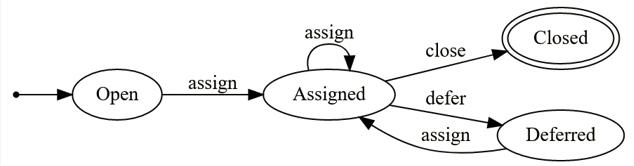
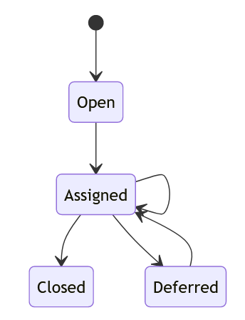
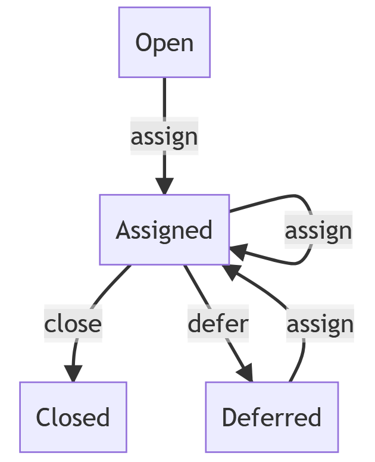

# AsyncStateMachine [](https://github.com/dschreib42/AsyncStateMachine/actions/workflows/ci.yml) [](https://www.nuget.org/packages/AsyncStateMachine)

**A framework for creating *state machines* and lightweight *state machine-based workflows* for Microsoft .NET**

```csharp
// Create a state machine configuration with the initial Open state.
var config = new StateMachineConfiguration<Trigger, State>(State.Open);

// Configure the Open state
config.Configure(State.Open)
    .Permit(Trigger.assign, State.Assigned);

// Configure the Assigned state
config.Configure(State.Assigned)
    .PermitReentry(Trigger.assign)
    .Permit(Trigger.close, State.Closed)
    .Permit(Trigger.defer, State.Deferred)
    .OnEntry<string>(assignee => OnAssignedAsync(assignee)) // asynchronous with parameter
    .OnExit(OnDeassignedAsync); // asynchronous without parameter

// Configure the Deferred state
config.Configure(State.Deferred)
    .OnEntry(() => _assignee = null) // synchronous
    .Permit(Trigger.assign, State.Assigned);

// Configure the Closed state
config.Configure(State.Closed)
    .OnEntry(() => Console.WriteLine("Bug is closed"));

// ...

// Instantiate a new state machine using the previously created configuration.
var stateMachine = new StateMachine<Trigger, State>(config);

// initialize the state machine to invoke the OnEntry callback for the initial state.
await stateMachine.InitializeAsync();

await stateMachine.FireAsync(Trigger.assign); // asynchronous
Assert.AreEqual(State.Assigned, stateMachine.CurrentState);
```

This project, as well as the example above, was inspired by [Stateless](https://github.com/dotnet-state-machine/stateless/).
The aim of this project is not to provide a one-to-one replacement of stateless. The goal was to provide a state machine providing
an asynchronous interface, lightweight implementation, easy to maintain and easy to extend. 

## Features

Most standard state machine constructs are supported:

 * Generic support for states and triggers of type struct (numbers, chars, enums, etc.)
 * Entry/exit actions for states (synchronous and asynchronous)
 * Guard clauses to support conditional transitions (synchronous and asynchronous)
 * Hierarchical states
 * Thread-safe, fully asynchronous API with cancellation support
 * Unit tested (code coverage >80%)

Some useful extensions are also provided:

 * Parameterized triggers
 * Reentrant states
 * Restoring a previously persisted state
 * Export state machine as graph (Graphviz/DOT, Mermaid Flow-Chart or Mermaid State-Diagram)

### Lifecycle

```csharp
var stateMachine = new StateMachine<Trigger, State>(config);

// Enter the initial state (invokes its OnEntry callbacks) ...
await stateMachine.InitializeAsync();

// ... or start in a specific state, e.g. one restored from a database.
await stateMachine.InitializeAsync(persistedState);

// Check whether a trigger is currently permitted.
bool canAssign = await stateMachine.CanFireAsync(Trigger.assign);

// Leave the current state (invokes its OnExit callbacks) and re-enter the initial state.
await stateMachine.ResetAsync();

// Releases the observable (subscribers are not notified with OnCompleted).
stateMachine.Dispose();
```

`InitializeAsync()` must be called before any trigger is fired, otherwise an `InvalidOperationException` is thrown.
Initializing with a state that was not configured throws an `ArgumentException`.
`CanFireAsync()` returns `false` if the state machine is not initialized, the trigger is not permitted or a guard clause throws.

### Entry/Exit actions

```csharp
// Configure the Assigned state
config.Configure(State.Assigned)
    .PermitReentry(Trigger.assign)
    .Permit(Trigger.close, State.Closed)
    .Permit(Trigger.defer, State.Deferred)
    .OnEntry<string>(assignee => OnAssignedAsync(assignee)) // asynchronous with parameter
    .OnExit(OnDeassignedAsync); // asynchronous without parameter
```

Entry/Exit actions can be used to apply certain functionality when a certain state is reached. The OnEntry() calls are all invoked when the state is reached and all OnExit() calls are invoked, when the state is changed. OnEntry() calls support synchronous and asynchronous functions as well as parameterized versions. Currently,
only a single parameter is supported. If several parameters are needed, then these must be encapsulated in a class/struct/pair. When multiple OnEntry/OnExit callbacks are registered, then all of them are executed in the order of registration.

### Guard Clauses

The state machine will choose between multiple transitions based on guard clauses, e.g.:

```csharp
config.Configure(State.SomeState)
    .PermitIf(Trigger.ab, State.A, () => Condition)
    .PermitIf(Trigger.ab, State.B, () => !Condition);
```

Depending on the guard clause, the trigger either transitions to state A or state B.
Guard clauses within a state must be mutually exclusive (multiple guard clauses cannot be valid at the same time).
The guard clauses will be evaluated whenever a trigger is fired. Guards should therefore be made side effect free.

Guard clauses can also be asynchronous:

```csharp
config.Configure(State.SomeState)
    .PermitIf(Trigger.ab, State.A, () => IsApprovedAsync());
```

### Parameterized Triggers

A strongly-typed parameter can be assigned to trigger:

```csharp
config.Configure(State.Assigned)
    .OnEntry<string>(email => OnAssigned(email));

// ...

await stateMachine.FireAsync(assignTrigger, "john.doe@example.com");
```

If no callback can be found handling the given type of argument, an ArgumentException is thrown.
If multiple parameters have to be passed into the attached callback, then wrap the parameters into a new class and pass a strongly-typed instance of that class into the FireAsync() call.
It doesn't matter if the callback is synchronous or asynchronous, both versions are supported out of the box. 

### Ignored Transitions and Reentrant States

Firing a trigger that does not have an allowed transition associated with it will cause an exception (InvalidOperationException) to be thrown.

To ignore triggers within certain states, use the `Ignore(...)` directive:

```csharp
config.Configure(State.Closed)
    .Ignore(Trigger.close);
```

Alternatively, a state can be marked reentrant so its entry and exit actions will fire even when transitioning from/to itself:

```csharp
config.Configure(State.Assigned)
    .PermitReentry(Trigger.assign)
    .OnEntry(() => SendEmailToAssignee());
```

By default, triggers must be ignored explicitly. Otherwise an exception (InvalidOperationException) is thrown.

### State Hierarchy

```csharp
config.Configure(State.A);
config.Configure(State.B)
    .SubstateOf(State.A);
config.Configure(State.C)
    .SubstateOf(State.B);
```

Defines a multi-level hierarchy where C is a sub-state of B, and B is a sub-state of A. The `CurrentState` property always returns the current (innermost) state.
`InStateAsync(...)` checks whether the machine is in the given state or in one of its sub-states:

```csharp
await stateMachine.InitializeAsync(State.C);

await stateMachine.InStateAsync(State.C); // true
await stateMachine.InStateAsync(State.A); // true, C is a (nested) sub-state of A
```

By default, `InStateAsync(state)` walks up to 5 levels of the hierarchy. For deeper hierarchies, pass the maximum depth explicitly
(up to `ushort.MaxValue`), e.g. `InStateAsync(State.A, maxDepth: 10)`.

### Observation

AsyncStateMachine provides an observable to propagate state changes:

```csharp
IDisposable subscription = stateMachine.Observable.Subscribe(
    t => Console.WriteLine($"{t.Source} --{t.Trigger}--> {t.Destination}"));

// ...

subscription.Dispose();
```

The observable is invoked whenever a transition is performed, including reentry transitions. `InitializeAsync()` and `ResetAsync()`
publish a transition into the initial state where `Source` and `Trigger` are `null`. Ignored triggers do not publish anything.

### Cancellation and Concurrency

All asynchronous methods accept an optional `CancellationToken`:

```csharp
using var cts = new CancellationTokenSource(TimeSpan.FromSeconds(5));

await stateMachine.FireAsync(Trigger.assign, "john.doe@example.com", cts.Token);
```

Calls to the state machine are serialized by an asynchronous lock, so it can safely be used from multiple threads.
The token cancels waiting for that lock: if it is cancelled before the call gets the lock, an `OperationCanceledException` is thrown
and the state machine is left unchanged. Once a transition has started, it runs to completion; the token is not passed to guard clauses or entry/exit actions.

Firing a trigger from within an entry action (e.g. to chain transitions) is supported.

### Export as graph

It can be useful to visualize state machines. With this approach the code is the authoritative source and state diagrams are always up-to-date.
Therefore AsyncStateMachine supports different graph engines like: Graphviz and Mermaid

#### Graphviz

```csharp
string graph = DotGraph.Format(config, GraphOptions.Default);
```

The `DotGraph.Format()` method returns a string representation of the state machine in the [DOT graph language](https://en.wikipedia.org/wiki/DOT_(graph_description_language)).

This can then be rendered by tools that support the DOT graph language, such as the [dot command line tool](https://graphviz.org/doc/info/command.html) from [graphviz.org](https://graphviz.org) or an online viewer for instant viewing.

The rendered bug StateMachine looks like this:


#### Mermaid

```csharp
string graph = MermaidStateGraph.Format(config);
```
The rendered mermaid state graph looks like this:


or 

```csharp
string graph = MermaidFlowChartGraph.Format(config);
```
The rendered mermaid flow graph looks like this:


The `Mermaid*Graph.Format()` methods return a string representation of the state machine in the [Mermaid graph language](https://mermaid.js.org).

This string representation can then be rendered by tools that support the mermaid graph language, such as Azure DevOPS or https://mermaid.live for instant viewing.

## Building

The AsyncStateMachine package targets .NET 6.0, .NET 7.0 and .NET Standard 2.0. Building the solution requires the .NET SDK 7.0 or later;
use the `dotnet` CLI or an IDE such as [Visual Studio 2022](https://visualstudio.microsoft.com/vs/) or [Visual Studio Code](https://code.visualstudio.com/Download):

```shell
dotnet build
dotnet test
```

## Project Goals

This page is an almost-complete description of AsyncStateMachine, and its explicit aim is to remain minimal.

Please use the issue tracker if you'd like to report problems or discuss features.
